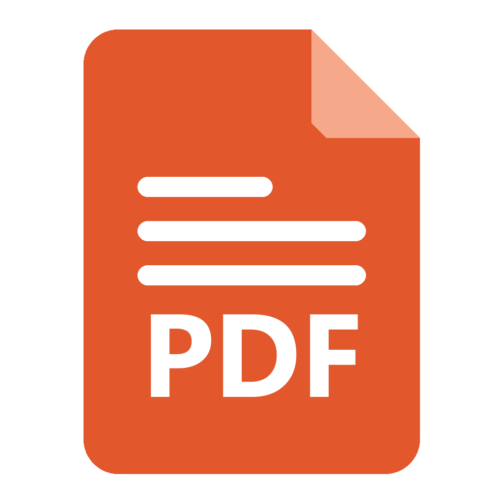

<p align="center"></p>

<h1 align="center">Mo-PDF</h1>

<p align="center">
Read, merge, split, rotate and compress PDFs: free, offline, no uploads.
</p>

<p align="center">
<a href="../../releases/latest"><b>⬇ Download the Windows installer</b></a>
</p>

---

## Features

**📖 Read**
- Fast PDF reader (built on Mozilla's PDF.js)
- Full-text search, zoom, page thumbnails, table of contents
- Printing
- Add text, freehand drawings and images, then save them to the PDF
- Shows up under "Open with" for PDF files

**✏ Edit**
- **Merge** multiple PDFs and images into one PDF
- **Reorder** pages with drag & drop; **rotate**, **delete** or **duplicate** pages
- **Extract** a selection of pages as a new PDF
- **Split** into single pages or every N pages (as a ZIP)
- Export pages as **PNG images**
- Add **watermarks** and **page numbers**
- **Images → PDF** (JPG, PNG, WebP …)
- **Compress** (best for scanned documents)

**🔒 Private:** Everything runs locally on your PC. Your files are never uploaded,
and the app doesn't need an internet connection.

> The app's interface is currently in German.

## Installation (Windows 10/11)

1. Download **`Mo-PDF-Setup.exe`** from [Releases](../../releases/latest).
2. Double-click it and choose **Installieren** (Install). No administrator rights needed.
3. Mo-PDF then appears in the Start menu and, if you choose, on the desktop.

> The installer is not digitally signed, so Windows may show "Windows protected your PC".
> Click **More info → Run anyway**.

Mo-PDF installs to `%LOCALAPPDATA%\Programs\Mo-PDF`. To uninstall, go to
**Settings → Apps → Mo-PDF**.

To make Mo-PDF your default PDF app: right-click a PDF → **Open with** →
**Choose another app** → **Mo-PDF** → **Always**.

## Building from source

Requirements: Windows, Python 3.12+ and Edge WebView2 (preinstalled on Windows 11).

```bat
python -m venv .venv
.venv\Scripts\python -m pip install pywebview pyinstaller
.venv\Scripts\python main.py        :: run the app directly
.venv\Scripts\python build.py       :: build Installer\Mo-PDF-Setup.exe
```

The interface (`app/index.html`) also runs in any modern browser without Python
if you serve the folder from a local web server, e.g. `python -m http.server`
→ `http://localhost:8000/app/`.

## Project structure

| File / folder | Purpose |
|---|---|
| `app/index.html` | The entire interface: reading and editing |
| `app/lib/` | pdf-lib, PDF.js and JSZip (bundled so the app works offline) |
| `app/viewer/` | PDF.js reader |
| `main.py` | Desktop window (pywebview + WebView2), save dialog, "Open with" support |
| `installer.py` | Setup and uninstaller (per user, no admin rights) |
| `build.py` | Builds `Mo-PDF.exe` and `Mo-PDF-Setup.exe` with PyInstaller |

## License

[MIT](LICENSE). Third-party components and their licenses are listed in
[THIRD_PARTY_NOTICES.md](THIRD_PARTY_NOTICES.md).
